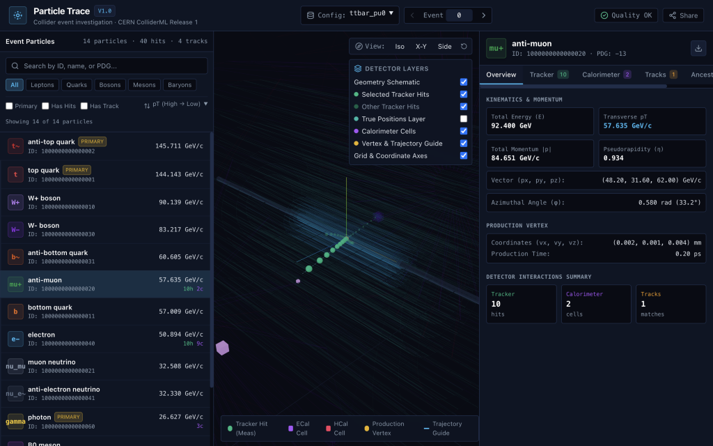
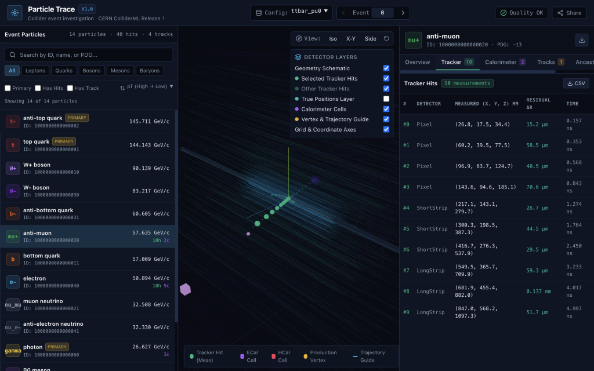
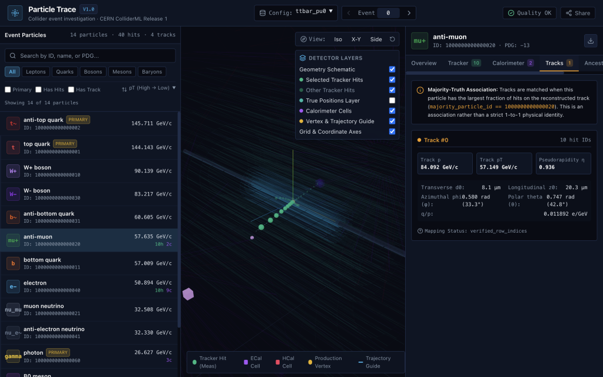
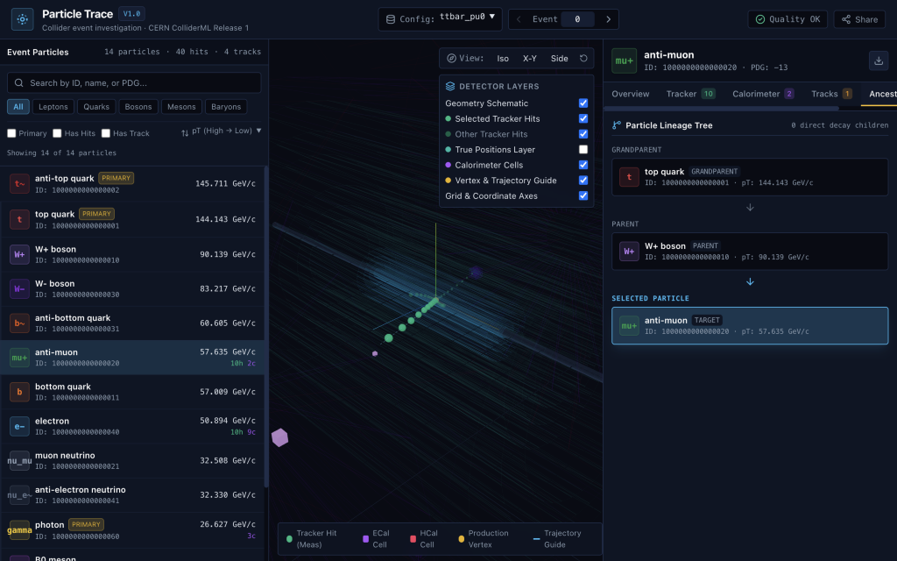

# Particle Trace

[](./LICENSE)
[](https://huggingface.co/datasets/CERN/ColliderML-Release-1)
[](https://www.typescriptlang.org/)
[](https://www.python.org/)
[](https://react.dev/)
[](https://threejs.org/)

**Particle Trace** is an interactive full-stack scientific application for investigating individual simulated particles across different detector representations in high-energy physics collision events.

Built for physicists, students, scientific software engineers, and machine learning researchers exploring open data from CERN, Particle Trace connects truth-level particles, tracker measurements, calorimeter energy deposits, reconstructed tracks, and decay ancestry into a synchronized, interactive workspace.

---

## The Core Investigation Workflow

```text
Select Particle -> Trace Detector Hits -> Inspect Reconstructed Track -> Explore Showers -> Follow Ancestry
```

Whenever you select a particle, the entire interface synchronizes:

- **3D Detector Scene:** Highlights the particle's measured tracker hits in vibrant emerald green, shows calorimeter cell deposits scaled by energy contribution, illuminates the production vertex, and renders a trajectory guide.
- **Particle Browser:** Displays searchable, filterable particle lists with standard PDG classification, electric charges, and kinematics.
- **Particle Inspector:** Shows total momentum, transverse momentum $p_T$, pseudorapidity $\eta$, azimuthal angle $\phi$, rest mass, and 3D production coordinates.
- **Tracker Explorer:** Compares measured positions $(x, y, z)$ against true pre-digitization coordinates $(\text{true\_x}, \text{true\_y}, \text{true\_z})$ and computes 3D residuals $\Delta r$.
- **Calorimeter Explorer:** Resolves multi-particle cell contributions, displaying particle-specific deposited energy, shower timing, and energy-weighted mean times.
- **Reconstructed Tracks:** Surfaces tracks associated via `majority_particle_id` with derived track momentum, $p_T$, and impact parameters.
- **Decay Ancestry Tree:** Explores parent-child decays, grandparents, and decay products with full bidirectional navigation.
- **Scientific Charts:** Dynamic Apache ECharts visualizations of momentum vectors, transverse/longitudinal coordinate projections, and timing profiles.

---

## Application Screenshots

### Scientific Investigation Workspace



### Interactive 3D Open Data Detector Visualization



### Particle Inspector & Detector Interactions



### Particle Decay Lineage Tree



---

## Scientific Data Model & Correctness Principles

Particle Trace adheres strictly to scientific correctness and CERN ColliderML conventions:

1. **64-Bit Integer Precision:**
   Particle IDs, parent references, and majority particle IDs are documented unsigned 64-bit integers. To eliminate JavaScript IEEE-754 precision loss, all identifiers are normalized and serialized as **decimal strings** in JSON bundles and compared as strings.
2. **Measured vs. True Positions:**
   Measured positions $(x, y, z)$ are strictly used for physical detector measurement displays. True positions are preserved in a dedicated comparison layer:
   $$\Delta r = \sqrt{(x - \text{true\_x})^2 + (y - \text{true\_y})^2 + (z - \text{true\_z})^2}$$
3. **Calorimeter Multi-Particle Contributions:**
   A calorimeter cell contains nested parallel arrays of contributions from multiple particles. Particle Trace never assigns the whole cell's `total_energy` to one particle; it extracts only the particle's aligned contribution energy and computes energy-weighted times:
   $$\bar{t} = \frac{\sum_k E_k \cdot t_k}{\sum_k E_k}$$
4. **Majority Truth Association:**
   Reconstructed tracks link to particles via `majority_particle_id`. This is presented as an association rather than a strict 1-to-1 physical identity.
5. **Selective Remote Ingestion:**
   The full ~28 TB dataset is never downloaded locally. Developers ingest configurable, small event samples (e.g. 10–20 events) or run against the bundled offline demo fixtures.

---

## Technology Stack

- **Frontend:** React 19, TypeScript, Vite, Tailwind CSS, Lucide Icons
- **3D Scientific Visualization:** Three.js, React Three Fiber (`@react-three/fiber`), Drei (`@react-three/drei`)
- **Scientific Charting:** Apache ECharts, `echarts-for-react`
- **Data Pipeline:** Python 3.10+, Pydantic v2, NetworkX, Polars/PyArrow, Boto3, Pytest
- **API & Cloud Hosting:** Cloudflare Pages Functions with optional Cloudflare R2 bucket binding

---

## Getting Started

### Prerequisites

- Node.js >= 20.0.0
- pnpm >= 10.0.0
- Python >= 3.10

### Installation

```bash
# Clone the repository
git clone https://github.com/ranajahanzaib/particle-trace.git
cd particle-trace

# Install frontend dependencies
pnpm install

# Setup Python virtual environment & pipeline dependencies
python3 -m venv .venv
.venv/bin/pip install -e pipeline/
```

### Running Locally (Demo Mode)

Particle Trace includes pre-packaged, verified event fixtures in `apps/web/public/data/` so it runs immediately out of the box without any network or storage prerequisites:

```bash
# Start the local development server
pnpm dev

# Or build and preview production build
pnpm build
pnpm --filter web preview
```

Open `http://localhost:3000` (or `http://localhost:4173`) in your browser.

---

## Data Pipeline CLI Commands

The Python processing pipeline (`pipeline/src/particle_trace`) provides reproducible commands for generating fixtures, ingesting events, validating bundles, and publishing to Cloudflare R2:

```bash
# Generate deterministic demo fixtures
.venv/bin/python3 -m particle_trace.cli generate-fixtures --channel ttbar --pileup pu0 --events 3

# Ingest and normalize collision events
.venv/bin/python3 -m particle_trace.cli ingest --channel ttbar --pileup pu0 --events 20 --output-dir ./data/processed

# Validate data integrity & generate diagnostics report
.venv/bin/python3 -m particle_trace.cli validate --target-dir ./data/fixtures

# Publish processed bundles to Cloudflare R2
.venv/bin/python3 -m particle_trace.cli publish --target-dir ./data/processed --bucket particle-trace-data
```

---

## Testing Suite

### Python Pipeline Tests (100% Passing)

```bash
PYTHONPATH=pipeline/src .venv/bin/pytest pipeline/tests
```

Verifies momentum calculations, pseudorapidity edge cases, track derived parameters, NetworkX ancestry DAGs and cycle detection, calorimeter parallel-list alignment, and bundle serialization.

### Frontend Unit & Component Tests

```bash
pnpm --filter web test
```

Verifies formatters, PDG resolution, tracker tables, calorimeter contribution summaries, particle search and filtering, and user selection synchronization.

---

## Cloudflare Pages and R2 Deployment

1. **Create an R2 Bucket:**
   ```bash
   npx wrangler r2 bucket create particle-trace-data
   ```
2. **Publish Processed Data:**
   Configure `.env` with R2 credentials and run:
   ```bash
   .venv/bin/python3 -m particle_trace.cli publish --target-dir ./data/processed
   ```
3. **Configure Pages Binding in `wrangler.toml` or Cloudflare Dashboard:**
   ```toml
   [[r2_buckets]]
   binding = "R2_BUCKET"
   bucket_name = "particle-trace-data"
   ```
4. **Deploy Application:**
   ```bash
   pnpm build
   npx wrangler pages deploy apps/web/dist
   ```

---

## Dataset Attribution and Citation

Particle Trace uses simulation data from the **CERN ColliderML Release 1** dataset:

- **Repository:** [https://huggingface.co/datasets/CERN/ColliderML-Release-1](https://huggingface.co/datasets/CERN/ColliderML-Release-1)
- **Documentation:** [https://opendatadetector.github.io/ColliderML/](https://opendatadetector.github.io/ColliderML/)
- **License:** Creative Commons Attribution 4.0 International ([CC-BY-4.0](https://creativecommons.org/licenses/by/4.0/))

### Citation

```bibtex
@dataset{colliderml_release1_2024,
  author    = {CERN ColliderML Collaboration},
  title     = {ColliderML Release 1: Simulated High-Energy Physics Collision Events},
  year      = {2024},
  publisher = {Hugging Face},
  url       = {https://huggingface.co/datasets/CERN/ColliderML-Release-1}
}
```

---

## License

This software is released under the [MIT License](./LICENSE).
